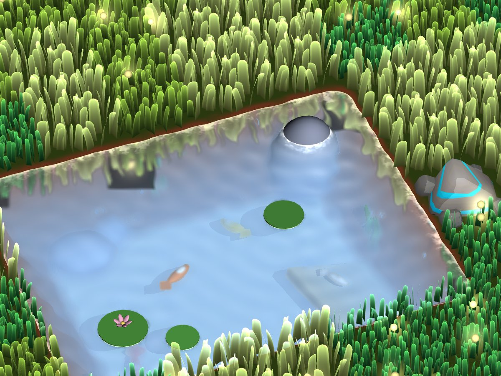
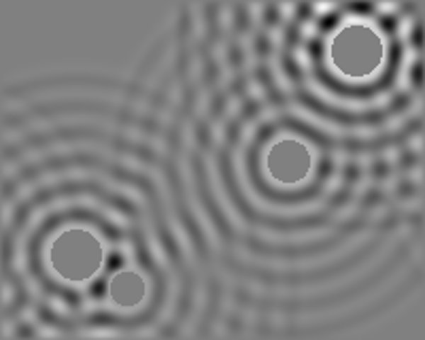
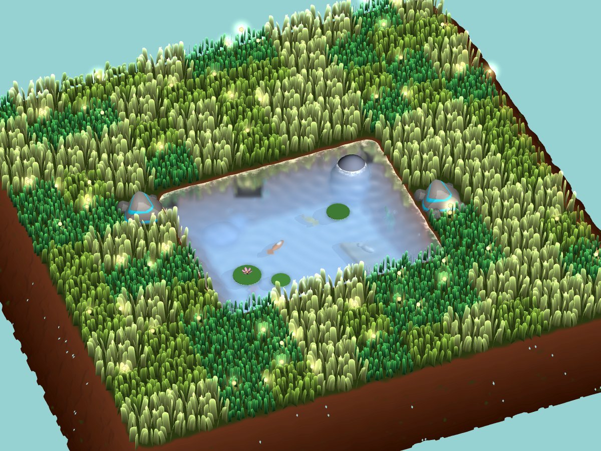
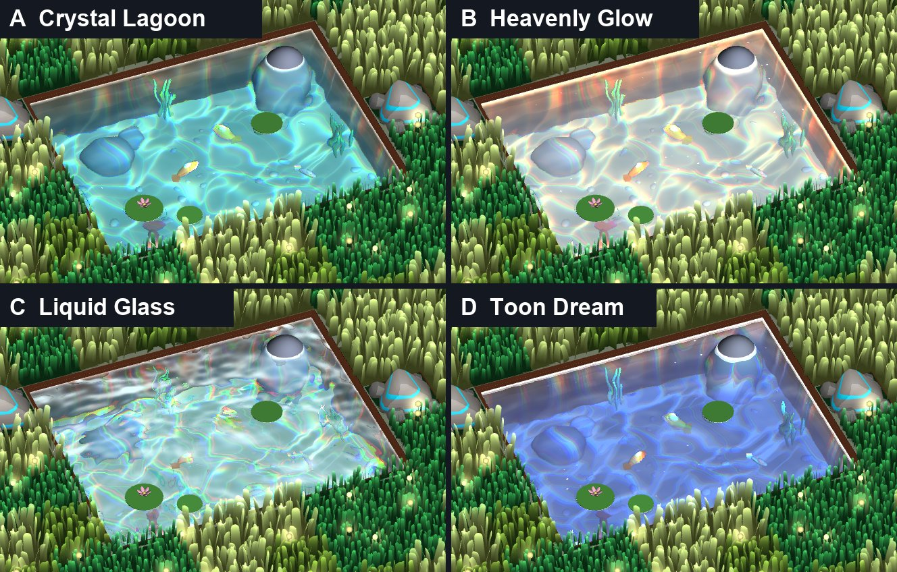
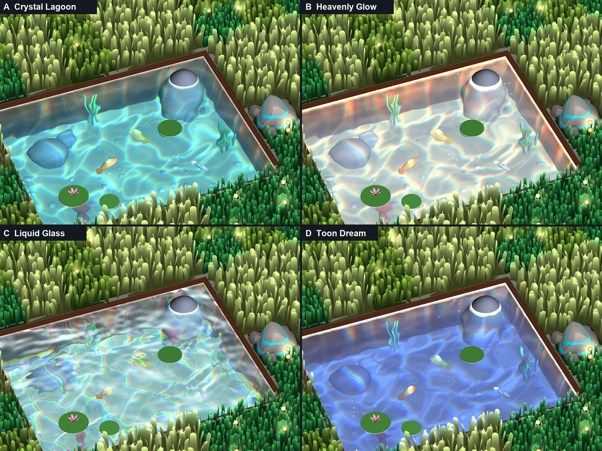
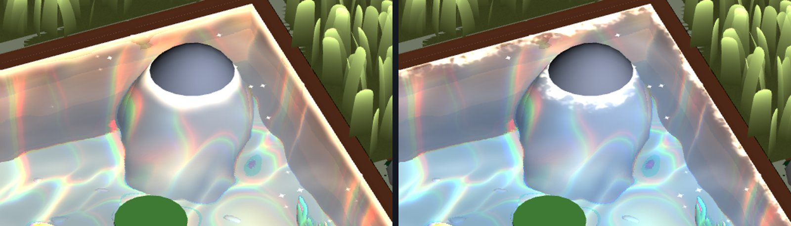
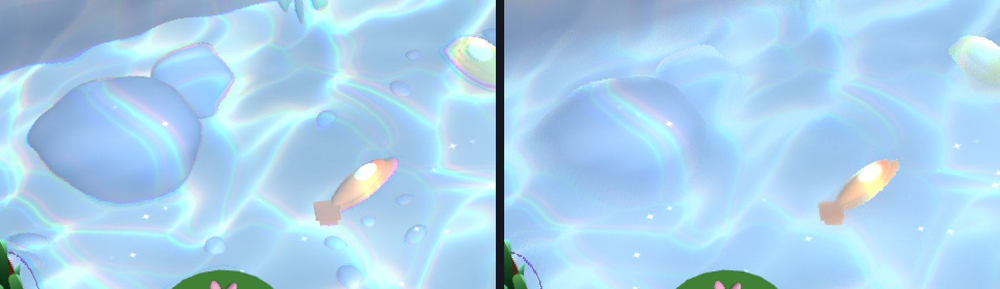
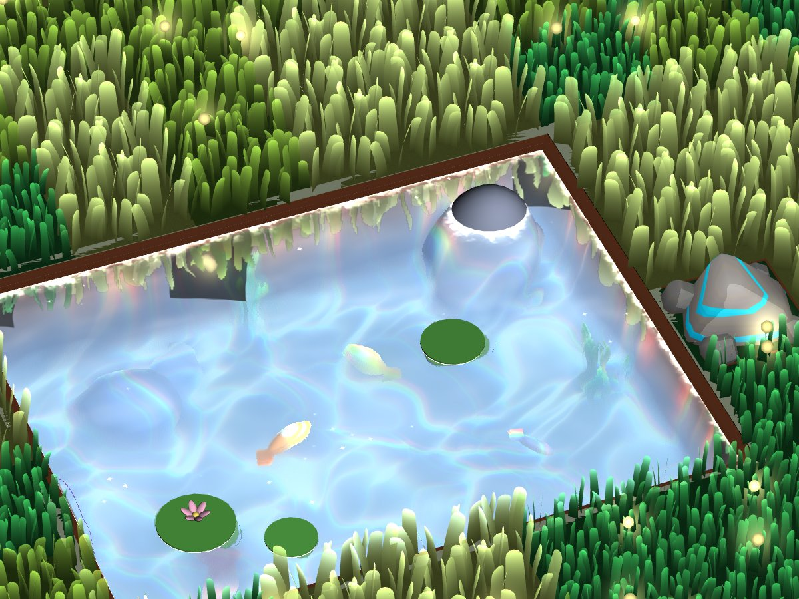
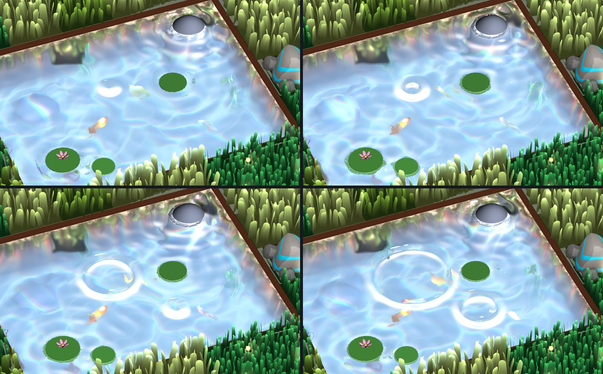
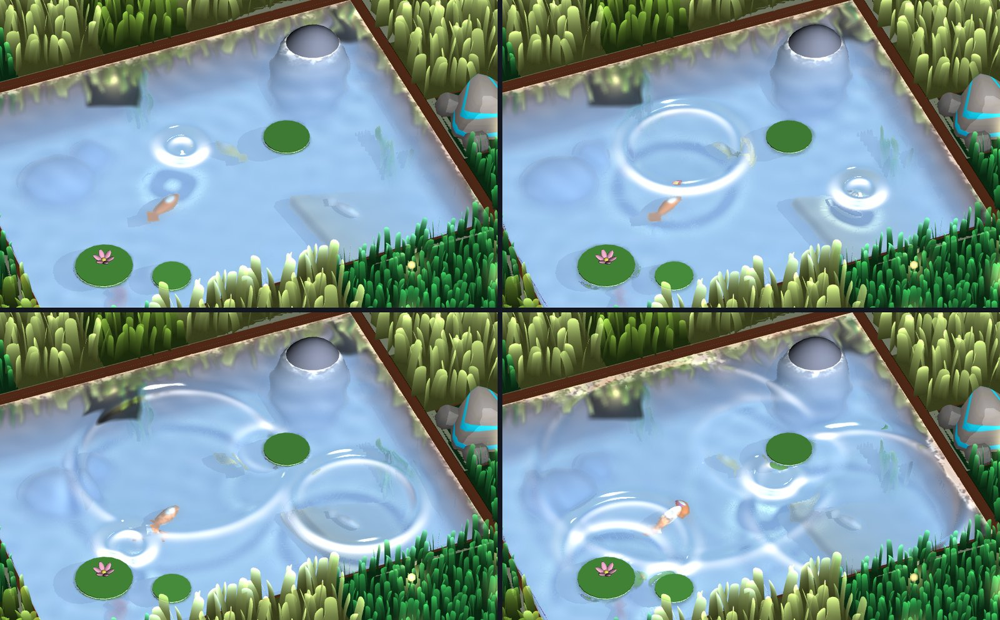

# Water

The pond water: a clear, glowing, heavily refractive surface whose motion comes from a ripple simulation that bounces off
walls and obstacles. This doc explains how it works, how to use it, and how we got here, including the options we tried
and dropped.



Videos: [final look with splashes](../../docs/images/water/final.mp4), [the four first variants](../../docs/images/water/variants.mp4).

## How it works

Five pieces:

| Piece | Path | Job |
|---|---|---|
| `Water` shader + `Water.mat` | `Assets/Shaders/Game/Tiles/Water/` | Draws the surface. Reads everything around it back from URP's Opaque and Depth textures. |
| `WaterRippleSimulation` | `Assets/Scripts/Presentation/Game/Tiles/` + `Hidden/WaterRippleSimulation` shader | Runs the 2D wave equation over a rectangle of water. The surface's shape comes from here. |
| `WaterRippleSource` | `Assets/Scripts/Presentation/Game/Tiles/` | Anything touching the surface (rock, lily pad, fish). Blocks ripples and, with strength > 0, sends out rings. |
| `PlanarWaterReflection` | `Assets/Scripts/Presentation/Game/Tiles/` | Renders the scene mirrored about the water plane at half resolution for reflections. |
| `PondManager` + `Pond.prefab` | `Assets/Scripts/Presentation/Game/Terrain/`, `Assets/Prefabs/Game/Tiles/Water/` | Builds each level's pond from its water tiles: the surface, a floor, and the ripple simulation's size and mask. |

For every water pixel the shader:

1. **Surface shape.** Samples the ripple simulation (and, if `Flow Waves Amount` > 0, a procedural flowing-wave
   noise) and takes a normal from finite differences.
2. **Refraction.** Reconstructs the 3D point behind the water from the depth texture, shifts it sideways in world space
   by the surface normal times its depth (`Refraction Strength`), and samples the opaque texture there, with a little
   chromatic aberration. Samples that land on something in front of the water are rejected.
3. **Depth blur.** Blurs that sample with a 16-tap disc whose world-space radius grows with depth (`Depth Blur`,
   capped by `Depth Blur Max`). Taps that hit things above the water are skipped.
4. **Caustics.** Light focused by the ripples: the curvature of the ripple surface above each underwater point (traced
   back along the sun) brightens it under crests and dims it under troughs, building with depth. Scaled by how much
   the point faces the sun, and removed where a short ray march towards the sun through the depth buffer is blocked
   (lily pads, overhangs, fish). Blocked points are also darkened (`Underwater Shadow Darkening`).
5. **Absorption and haze.** Light fades per channel with path length (`Absorption`), and the colour mixes towards
   `Deep Colour` with depth (`Haze Density`, up to `Haze Amount`).
6. **Reflection.** A sky gradient weighted by fresnel, then the planar reflection texture (mip-blurred and rippled)
   blended in with an exaggerated `Object Reflection Strength` so it reads from the steep game camera.
7. **Highlights and glow.** Sun specular, twinkling sparkles on crests, a constant glow, and a shallow-edge glow where
   the water is thin (walls, rocks, lily pads). The edge band's reach and lacy breakup come from 3D noise that only
   moves along Y, so it reshapes in place, and it swells and retreats with passing ripples.



*The ripple simulation's height field from above: rings from the rock and lily pads bouncing off the pond walls and
interfering.*

## In the game

Water tiles don't get a tile object each (`TilePrefabsManager` still has no water prefab). Instead `Pond.prefab`, under
the `Terrain` object in `Game.unity`, fills every level's water tiles with one pond when the level starts:

- **One surface mesh** (`Water`, on the Water layer, with the level's `WaterRippleSimulation` and
  `PlanarWaterReflection`) covering the water tiles plus each quarter of a solid tile that borders them, so
  it tucks under the terrain's inset banks. One mesh rather than a quad per tile, because overlapping transparent quads
  would blend twice where they overlap.
- **One floor** (`PondFloor`, `PondFloor.mat`) with the same shape, `Floor Depth` (0.95) below the terrain top, since
  the terrain is open underneath. One-tile-wide channels close up above it: the banks meet at about −0.7.
- **The ripple simulation** sized to the pond's bounds, with a **mask** of open water: texels inside the pond and
  outside the terrain's SDF at the water's height, so ripples bounce off the real, rounded, noisy shoreline rather than
  the rectangle's edges. A level with no water hides the surface and floor, which also switches off the simulation and
  reflection.
- **Wood tiles next to water are bridges**, so the pond runs under them (Level 9).
- Being under `Terrain`, the pond rises with it in the level intro.

- **Bumping into a water tile splashes it,** a little way in from the side the mower came from.

Water that reaches the edge of the level stops there, over the ocean (Levels 8 and 9). Otherwise nothing disturbs the
water yet: there are no `WaterRippleSource`s in ponds, so between bumps it's still.

## Using it

- **Pipeline:** `Depth Texture` and `Opaque Texture` must be on in `UniversalRenderPipelineAsset` (they are now, with
  opaque downsampling off).
- **Things under or around the water must be opaque.** Anything in the transparent queue won't be refracted or blurred
  (it isn't in the opaque texture). Floating things like lily pads should sit just above the surface.
- **Water renderers go on the `Water` layer (4).** `PlanarWaterReflection` leaves that layer out so the water doesn't
  reflect itself.
- **One `PlanarWaterReflection`** at the water surface height. It follows `Camera.main` unless given a camera, and
  renders in `LateUpdate`, so reflections only update in Play mode.
- **One `WaterRippleSimulation`** centred on the water, with `Size` set to the water's XZ extent. Its edges act as
  walls.
- **A `WaterRippleSource`** on each rock, lily pad or other thing that touches the surface. `Radius` is its footprint
  at the waterline; `Strength` 0 only blocks ripples. The default is 0.2: quiet. Up to 16.
- **Splashes:** call `waterRippleSimulation.Splash(position, radius, strength)` when something lands in the water, e.g.
  a frog with `radius: 0.08f, strength: 1.5f`. Up to 8 per simulation step.

### With the SDF terrain

The level terrain (`TerrainManager`) only treats grass, stone and spring tiles as solid, so water tiles are holes in it
with rounded corners and banks that slope outwards below the surface. That suits the water: the banks are opaque, so
they're refracted, hazed and blurred, catch caustics on their slopes, and give the shallow-edge glow a natural rounded
shoreline. Two things to know:

- **Make the water mesh bigger than the hole.** Above the terrain's pivot height its sides are inset from the tile grid,
  so water exactly the size of the water tiles leaves a gap at the bank. The preview extends it half a tile on every
  side, where the terrain top hides it.
- **The terrain has no pond floor.** Its bottom is open over the ocean, and the ocean is transparent, so it isn't in the
  opaque texture the water refracts. A pond needs its own floor (the preview uses a sand slab at −0.95), or the terrain
  could close its bottom under water tiles.



### Previewing outside Play mode

`Assets/Editor/WaterPreview/WaterPreviewRenderer.cs` builds a test pond in the level's SDF terrain with real grass and
stone tiles, plus a sand floor and primitive rocks, fish, plants, a sloped sandbank and lily pads, and renders it from
the game camera:

```bash
Unity -batchmode -quit -projectPath . -executeMethod WaterPreviewRenderer.Render -logFile water.log
```

Stills go to `Temp/water` (override with `WATER_OUT`). `WATER_VIDEO=1` records a real-time clip of the close shot with
four splashes as raw RGB24. The file header lists the other options and the ffmpeg command to encode it.

## How we got here

### Starting point

- `Water.shader` was an Amplify-generated, opaque, cel-shaded blue gradient. Nothing used it.
- `Water.mat` was actually a URP Lit material, and no water tile prefab is assigned in `TilePrefabsManager`, so water
  tiles render nothing in-game. Hooking water up to tiles came later; see "In the game".
- The pipeline had the depth and opaque textures off, which refraction needs.

The brief: properly transparent, lots of refraction, fluid flow, inviting and crystalline, with exaggerated physical
properties so the effect reads, and ready for rocks, fish, plants and lily pads later.

### Round 1: four variants

One rewritten shader, four material presets, rendered with primitives standing in for the future models.




| Variant | Idea | Outcome |
|---|---|---|
| **A, Crystal Lagoon** | Clear turquoise, curvy white caustics, soft edge glow. Most readable. | Not chosen. |
| **B, Heavenly Glow** | Pale, pearly, gold caustics and edges, crest glow and sparkles. | **Chosen.** Everything since builds on it. |
| **C, Liquid Glass** | Near-colourless, very strong refraction, rainbow chromatic aberration and caustics. | Too busy: objects broke apart. |
| **D, Toon Dream** | Periwinkle water with stepped (cel-shaded) caustics, highlights and edges. | Not chosen. `Toon Steps` remains as a setting. |

Problems fixed along the way:

- **Material showed black, then grey.** `Water.mat` was a Lit material and none of the new properties existed, so
  they read as zero. It now points at the Water shader with no overrides, so it uses the shader defaults.
- **Caustics had lost their colour.** A helper took a scalar and silently truncated the RGB caustics to one channel.
- **Refraction changed with zoom and broke objects into blobs.** It was a screen-space offset; it's now a world-space
  shift of the point behind the water, scaled by its depth.
- **Grey-brown blotches** in C were screen-space reflections of the floor and the brown bank, from steep waves sending
  rays down or sideways. Fixed by clamping the reflection ray upwards and fading near-horizontal hits.
- **Sparkles were square dots;** they became small four-point stars.
- **First frames rendered with wrong colours** (beige lily pads) until materials warmed up; the preview renders a few
  throwaway frames first.

### Round 2: refining Heavenly Glow

- **Slightly bluer.** Shallow tint, deep colour, sky, and glow shifted towards blue; slightly more red absorption. The
  gold caustics stayed as an accent, the gold edge became near-white.
- **Noisier shallow edges.** The edge band was smooth with one gentle wobble. It became layered noise with lacy gaps
  and a solid contact line.

  

- **The edge noise slid across the surface.** It was scrolled in X and Z and also rode the flowing waves. It now uses
  3D noise moved only along Y, so it changes in place, and no longer uses wave height.
- **Haze ×5 didn't show.** The haze hit its 50% cap within ~0.15 units of depth, so everything underwater got the same
  tint and depth didn't read. Retuned (density 1.8, cap 0.7) so it builds across the pond.
- **Real depth blur.** Added the 16-tap blur that grows with depth. The first version did nothing: the projection
  matrix's vertical term is negative when rendering to a texture, so the radius came out negative. Fixed with `abs`.

  

- **Animation at half speed** via a single `Animation Speed` multiplier.

### Round 3: reflections

The shader already reflected the sky and did screen-space reflections, but from the steep telephoto camera they were
nearly invisible, and screen-space reflections can't see the grass because it renders as transparent.

- **Replaced screen-space reflections with a planar reflection** (`PlanarWaterReflection`): a mirrored camera renders
  the scene with an oblique near plane at the water height into a half-resolution texture. This picks up the grass,
  rocks and anything added later, and removed the 16-step reflection loop from every water pixel. It uses URP's
  `SubmitRenderRequest`, since `RenderSingleCamera` is obsolete.
- **Blurred reflections** using mipmaps plus four offset taps, and **edge glow intensity** cut from 1 to 0.45.

  

### Round 4: ripples

From a reference photo of rings spreading round a stone:

1. **Formula rings.** Each `WaterRippleSource` added expanding sine rings to the surface height. Two versions were
   shown: on the flowing water, and on calmer water (weaker waves and swirl) where they read better. The first one's
   strength was preferred.
2. **Slower and wider.** Speed halved and ring spacing doubled.
3. **Bouncing.** Formula rings can't interact with anything, so they were replaced by `WaterRippleSimulation`: the 2D
   wave equation on a ping-pong render texture, ~40 texels per unit, fixed 60 Hz steps. Sources drive a ring at their
   edge; their insides and the rectangle edges are held at zero, so waves reflect and interfere. Three bugs on the
   way:
   - **Everything read 0.5:** `_MainTex` wasn't declared in the simulation shader's Properties block, so
     `Graphics.Blit` never bound it and every step sampled Unity's default grey texture.
   - **Waves died within four texels:** half-float textures can't hold the tiny per-step changes of slow waves. Now
     32-bit float.
   - **Slow waves wouldn't travel at all:** damping was applied by scaling the whole update, which acts like a
     restoring force with a cutoff frequency (~4.4 rad/s) above the ripples' 2.45 rad/s. Only the velocity term is
     damped now.
4. **Ripples only.** The original flowing waves were switched off (`Flow Waves Amount` 0, not deleted) and ripple
   strength doubled.
5. **Edges follow ripples**, clamped to the edge band's width. Unclamped, a splash's deep trough made open water read
   as shallow and flashed a white blob.
6. **Dynamic splashes** (`Splash`) for things landing in the water.

   

7. **Speed doubled back** to 0.25 units/s, and **caustics toned down** (the old ones animated independently of the now
   still surface).

### Round 5: caustics from the ripples

- **Caustics now come from the ripple surface's curvature** instead of an animated Voronoi web, so splashes and rings
  cast matching bright and dark bands on the floor. With the water still, the floor is plain.
- **Static objects quietened** to about a fifth (source default 1 → 0.2) so splashes dominate.
- **Arbitrary geometry.** Caustics, haze, blur and edges were already per-pixel on the real 3D point, so sloped floors
  and rocks work. Two gaps were fixed:
  - **Facing:** a normal is rebuilt from screen-space derivatives and caustics scale by how much it faces the sun.
  - **Shadowing:** a 12-step ray march towards the sun through the depth buffer. Turning on the main light's shadow
    map was the alternative, but it would change lighting and cost across the whole game, so the shadows are kept
    inside the water shader.

  

## Options tried and not used

- **Variants A (Crystal Lagoon), C (Liquid Glass) and D (Toon Dream).** C's settings are worth revisiting for a magic
  pool; D's stepped look is still available through `Toon Steps`.
- **Procedural flowing waves** (layered gradient noise with swirl). Still in the shader behind `Flow Waves Amount`.
- **Calm-water variant** (wave strength 0.3, swirl 0.3), superseded by turning the flowing waves off.
- **Screen-space reflections.** Replaced by the planar reflection.
- **Analytic formula ripples.** Replaced by the simulation.
- **Animated Voronoi caustics,** including a rainbow version. Replaced by ripple-driven caustics.
- **Shadow-map shadows for caustics.** Considered, not built; see above.
- **Haze ×5 with a 0.5 cap.** Didn't read; retuned.

## Known limitations and follow-ups

- **Only bumps disturb the water in the game.** Ponds have no ripple sources (rocks, lily pads) yet.
- **One simulation per level.** Every pond in a level shares one rectangle; with separate ponds far apart most of it is
  masked out and wasted.
- **iPhone performance hasn't been measured.** Per water pixel: up to 32 texture reads for the depth blur, 12 depth reads
  for the shadow march, 6 ripple reads for caustics and edges, plus a half-resolution scene render per frame for
  reflections and a 200×160 simulation step twice per frame. Expect to trim taps and steps.
- **Planar reflections may be vertically flipped on device.** They were only checked in the preview, which renders to
  a texture. A one-line fix if so.
- **Screen-space shadows only come from on-screen things,** and very thin objects give slightly stepped edges.
- **The underwater sun direction is approximate** (a fixed slope rather than refracted at the surface).
- **Ripple sources emit steady rings.** A moving source makes rings, not a V-shaped wake.
- **The depth texture is now on for everything.** The Ocean's shoreline foam reads it too; together with the renderer's
  Copy Depth Mode set to After Opaques on master, both the ocean and the water get the opaque scene's depth.
